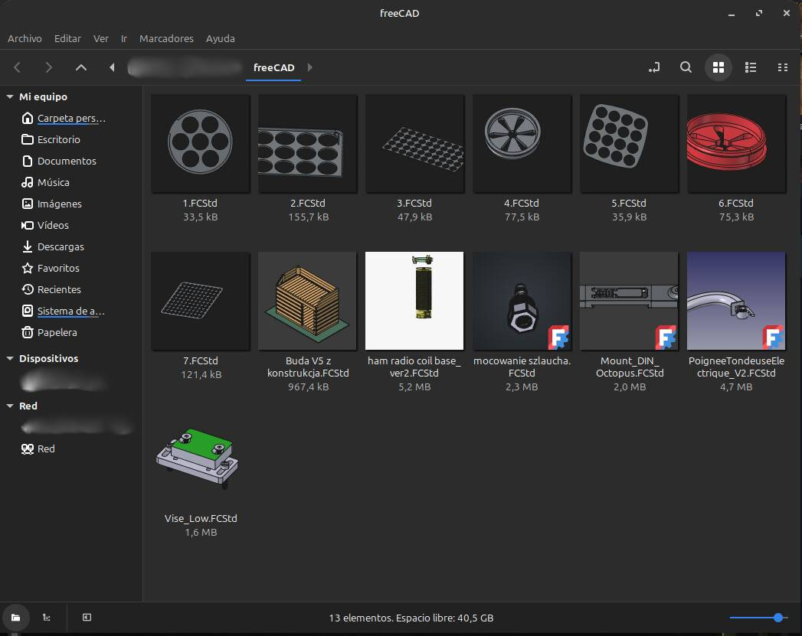

# freecad-thumbnailer-setup

> [English](README.md) · **Español**



*Archivos `.FCStd` de FreeCAD mostrando su miniatura incrustada en el explorador de archivos.*

Instalador de un solo fichero (bash) que añade **miniaturas para los archivos `.FCStd` de FreeCAD** en tu explorador de archivos (Nemo, Nautilus, Dolphin, Thunar, Caja, PCManFM) y activa la opción *“Guardar la miniatura…”* de FreeCAD para que la vista previa viaje dentro de cada archivo de modelo.

- 🖼️ Vista previa del modelo directamente en el explorador, en lugar del icono genérico
- 📦 Un único script: `bash` + `python3`, sin instalar dependencias previas
- 🧰 Menú interactivo, panel de estado, dry-run, diagnóstico y archivo de prueba
- ↩️ Cada cambio de ajuste queda registrado para que `--uninstall` restaure el estado anterior
- 🐧 Debian/Ubuntu (Mint…), Fedora/Bazzite (rpm-ostree), Arch y openSUSE

## Prólogo

Hace tiempo que quería algo muy sencillo, y que FreeCAD nunca me dio por su cuenta: **ver cómo es un archivo `.FCStd` ahí mismo, en el explorador de archivos**, sin tener que abrirlo primero en FreeCAD. Sabía que había maneras de conseguirlo, pero todas las que encontré eran algo tediosas: copiar un script por aquí, editar un archivo de configuración por allá, y acordarme de repetirlo en cada equipo. Lo hice un par de veces, acabé abandonando y seguí adivinando qué cubo era cuál por el nombre del archivo.

Un día decidí cambiar de enfoque: en lugar de seguir una receta larga a mano, pedí a una IA agéntica que lo hiciera conmigo. Usé [OpenCode](https://opencode.ai) a través de su versión de terminal, le conté lo que quería — *«quiero ver las miniaturas de FreeCAD en mi explorador de archivos, y quiero poder deshacerlo después»* — y la dejé acompañarme en todos los pasos de instalación: detectar el sistema y el explorador, instalar el thumbnailer, activar la propia opción de FreeCAD y comprobar que de verdad funcionaba.

Lo que empezó como una sola petición fue tomando forma a medida que probábamos, encontrábamos bultos y los corregíamos, conversación tras conversación, hasta convertirse en el script que tienes hoy en este repositorio.

Espero que te ahorre el rollo que a mí me ahorró.

---

## Índice

- [Prólogo](#prólogo)
- [Inicio rápido](#inicio-rápido)
- [Uso](#uso)
- [Opciones](#opciones)
- [Qué cambia](#qué-cambia)
- [Cómo funciona](#cómo-funciona)
- [Exploradores compatibles](#exploradores-compatibles)
- [Desinstalación](#desinstalación)
- [Solución de problemas](#solución-de-problemas)
- [Estructura del repositorio](#estructura-del-repositorio)
- [Desarrollo](#desarrollo)
- [Créditos y licencia](#créditos-y-licencia)

## Inicio rápido

```bash
git clone https://github.com/carlymx/freecad-thumbnailer-setup.git
cd freecad-thumbnailer-setup
chmod +x freecad-thumbnailer-setup.sh
./freecad-thumbnailer-setup.sh
```

Ejecutado sin argumentos abre el panel de estado y un menú de tres opciones:

```
== freecad-thumbnailer-setup 2.1 — panel de inicio
  SO               : Linux Mint 22.3 — compatible (debian, gestor apt)
  FreeCAD          : flatpak org.freecad.FreeCAD 1.1.3
  Explorador(es)   : nemo (xdg: nemo.desktop, sesion: X-Cinnamon)
  Modulo (MOD)     : instalado (user, 4/4)
  Previsualizacion : nemo show-image-thumbnails='local-only'; FreeCAD SaveThumbnail=activo
  Modo instalacion : user

  1 Instalar      (ficheros, ajustes de FreeCAD/explorador y verificacion)
  2 Desinstalar   (quita el modulo y restaura los ajustes previos)
  q Salir

  Seleccion:
```

## Uso

| Comando | Qué hace |
| --- | --- |
| `./freecad-thumbnailer-setup.sh` | Panel de estado + menú interactivo (necesita terminal) |
| `./freecad-thumbnailer-setup.sh --user` | Instala solo para tu usuario, sin sudo |
| `./freecad-thumbnailer-setup.sh --system` | Instala en todo el sistema (pide la contraseña de sudo) |
| `./freecad-thumbnailer-setup.sh --dry-run` | Muestra cada acción sin cambiar nada |
| `./freecad-thumbnailer-setup.sh --status` | Diagnóstico completo, de solo lectura |
| `./freecad-thumbnailer-setup.sh --test` | Solo comprueba que el generador funciona |
| `./freecad-thumbnailer-setup.sh --demo` | Crea un `.FCStd` de prueba en el escritorio |
| `./freecad-thumbnailer-setup.sh --uninstall` | Desinstala y restaura los ajustes previos |
| `./freecad-thumbnailer-setup.sh --help` | Resumen de opciones |

Sin terminal (pipe, cron) y sin argumentos instala directamente, para no bloquearse esperando una respuesta.

## Opciones

| Opción | Efecto |
| --- | --- |
| `--yes`, `-y` | No pregunta (acepta los paquetes opcionales) |
| `--force` | Continúa aunque el SO o el explorador no sean compatibles |
| `--user` / `--system` / `--auto` | Modo de instalación (por defecto: auto) |
| `--dry-run` | Simula: imprime en lugar de ejecutar |
| `--full-cache` | Borra también las miniaturas ya generadas |
| `--keep-cache` | No toca la caché de miniaturas |
| `--no-deps` | No ofrece paquetes opcionales (`tumbler`, `kde-fcstd-thumbnailer`) |
| `--no-config` | No cambia la configuración de FreeCAD ni del explorador |
| `--no-test` | Omite la verificación final |
| `--no-restart` | No reinicia el explorador de archivos |

Se pueden combinar, por ejemplo `./freecad-thumbnailer-setup.sh --user --no-restart`.

## Qué cambia

**Ficheros** (modo usuario; con `--system` van a `/usr`):

```
~/.local/bin/freecad-thumbnailer.py                       generador de miniaturas
~/.local/share/thumbnailers/FreeCAD.thumbnailer           entrada .thumbnailer de freedesktop
~/.local/share/mime/packages/org.freecadweb.FreeCAD.xml   tipo MIME de .FCStd
~/.local/share/icons/hicolor/48x48/apps/freecad.png       icono de respaldo
```

**Ajustes** (se guardan antes, para que `--uninstall` pueda deshacerlos):

- `show-image-thumbnails` / `thumbnail-limit` en Nemo, Nautilus y Caja
- `/misc-thumbnail-mode` en Thunar (necesita el paquete `tumbler`)
- `[PreviewSettings] Plugins=` en `dolphinrc` (o `kde-fcstd-thumbnailer`)
- los esquemas de thumbnailers (`disable` / `disable-all`) de cinnamon/gnome/mate
- `SaveThumbnail=1` en el `user.cfg` de FreeCAD (se guarda copia `.bak-thumbnailer`)

**Estado y log**: `~/.local/state/freecad-thumbnailer-setup/{state,setup.log}`.

No se escribe nada fuera de esas rutas, y en `--dry-run` no se ejecuta ninguna modificación.

## Cómo funciona

1. **Generador** – `freecad-thumbnailer.py` lee la miniatura incrustada (`thumbnails/Thumbnail.png`) del `.FCStd` (que es un zip). Si el archivo no trae una, usa el icono de FreeCAD o pide a `FreeCADCmd` (PATH, flatpak o snap) que la genere.
2. **Registro** – escribe el tipo MIME `application/x-extension-fcstd` y publica `FreeCAD.thumbnailer`, que el escritorio descubre en `~/.local/share/thumbnailers` (esa carpeta la miran primero cinnamon-desktop, tumbler y compañía).
3. **Activación** – habilita la previsualización en el explorador detectado y pone `SaveThumbnail` en FreeCAD, de forma que los próximos guardados lleven la vista previa dentro.
4. **Limpieza y verificación** – borra `~/.cache/thumbnails/fail`, reinicia el explorador y lo comprueba generando una miniatura de prueba y consultando la fábrica de miniaturas del escritorio.

## Exploradores compatibles

| Explorador | Escritorio | Notas |
| --- | --- | --- |
| Nemo | Cinnamon | nativo, vía `cinnamon-desktop` |
| Nautilus | GNOME | nativo |
| Caja | MATE | nativo |
| Thunar | XFCE | necesita el paquete `tumbler` (se ofrece al instalar) |
| Dolphin | KDE | Plasma ≥ 6.6, o `kde-fcstd-thumbnailer` (se ofrece) |
| PCManFM / PCManFM-Qt | LXDE / LXQt | con los thumbnailers estándar de freedesktop |

Distribuciones compatibles: Debian/Ubuntu (Mint, LMDE, Ubuntu, Pop!\_OS, elementary, Zorin), Fedora / Bazzite / Silverblue (inmutable, usa `rpm-ostree`), Arch / Manjaro, openSUSE.

## Desinstalación

```bash
./freecad-thumbnailer-setup.sh --uninstall
```

Borra los ficheros instalados, restaura todos los ajustes y la configuración de FreeCAD desde el estado guardado, limpia los fallos de miniaturas y reinicia el explorador. Añade `--dry-run` para previsualizarlo.

## Solución de problemas

- **Empieza por** `./freecad-thumbnailer-setup.sh --status`: imprime qué detecta el script y si el módulo está instalado.
- **No se ve ninguna miniatura**: *Ver > Vista de iconos* y *Preferencias > Previsualización = Archivos locales* (Nemo/Nautilus); Thunar: *Preferencias > Mostrar miniaturas*; Dolphin: *Configurar Dolphin > General > Previsualizaciones*.
- **Se dejaron de ver**: `rm -rf ~/.cache/thumbnails/fail` y reinicia el explorador (`--full-cache` vacía toda la caché).
- **FreeCAD no guarda la miniatura**: *Editar > Preferencias > General > Documento > “Guardar la miniatura en el archivo del proyecto al guardar”*.
- **Archivo copiado de otro equipo**: vuelve a guardarlo en FreeCAD con `SaveThumbnail` activo.
- **Mira el log**: `~/.local/state/freecad-thumbnailer-setup/setup.log`.

## Estructura del repositorio

```
freecad-thumbnailer-setup/
├── freecad-thumbnailer-setup.sh   # toda la herramienta (bash, autocontenido)
├── README.md                      # documentación en inglés
├── README_ES.md                   # este archivo
├── PLAN.md                        # hoja de ruta, estado y notas para mantenedores/agentes
├── LICENSE                        # MIT
├── .gitignore
└── media/
    └── Screenshot_01.jpg          # captura de portada
```

## Desarrollo

Comprobaciones que se ejecutan antes de dar un cambio por bueno:

```bash
bash -n freecad-thumbnailer-setup.sh              # sintaxis
shellcheck -S style freecad-thumbnailer-setup.sh  # análisis estático (se espera 0 avisos)
./freecad-thumbnailer-setup.sh --status           # diagnóstico de solo lectura
./freecad-thumbnailer-setup.sh --dry-run          # imprime todas las acciones, no cambia nada
```

Convenciones: `set -Eeuo pipefail`, nada de sentencias `cmd && cmd` sueltas (abortarían con `errexit`), toda orden que modifica pasa por `run()` o por un guard explícito de `--dry-run`, los mensajes de usuario son texto plano en español sin acentos, y las marcas `# >>> DOCUMENTACION` … `# <<< DOCUMENTACION` de la cabecera mantienen la documentación completa fuera de `--help`.

## Créditos y licencia

- Formato de miniatura y generador original: [andesfreedesign/FreeCAD-thumbnailer](https://github.com/andesfreedesign/FreeCAD-thumbnailer) (MIT).
- Este script de instalación y su documentación: [carlymx](https://github.com/carlymx), publicado bajo la [Licencia MIT](LICENSE).
